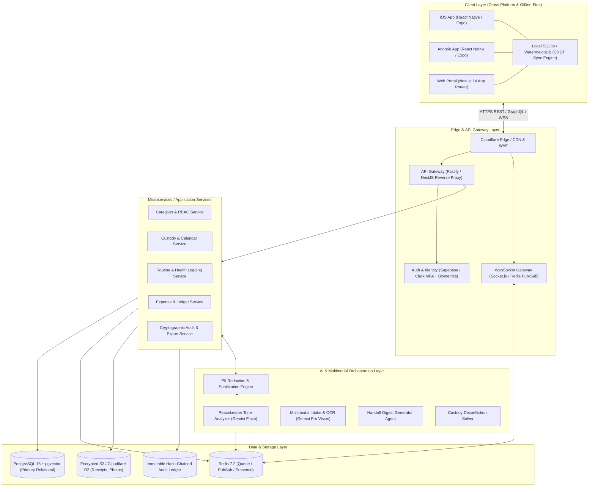
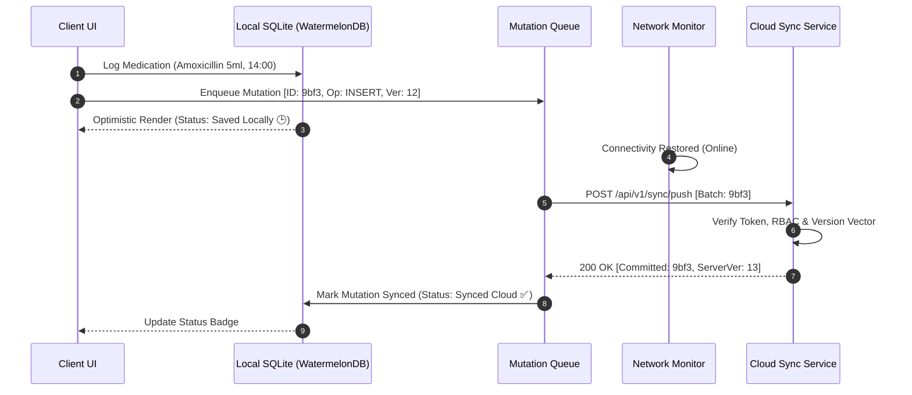
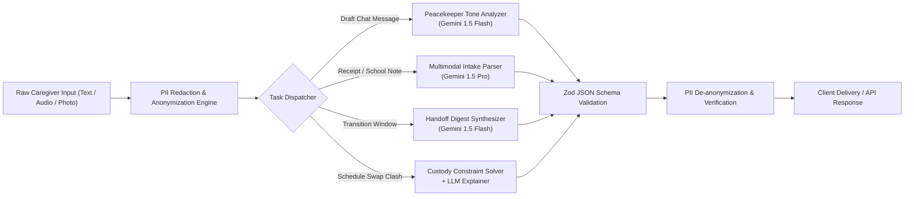
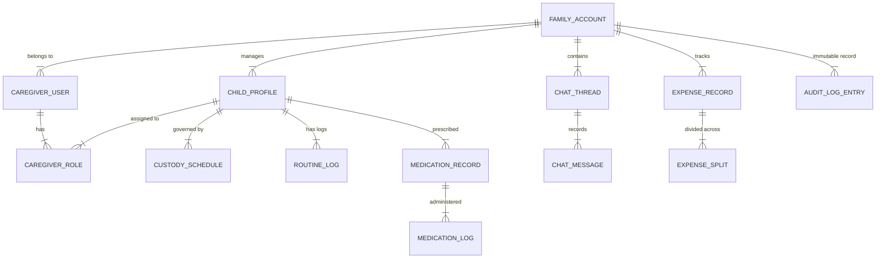
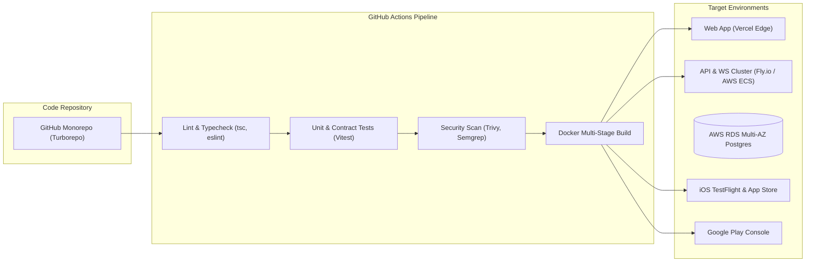

# System Architecture & Technical Specification
## Project: KidSync AI
### Document Version: 1.0.0 | Status: Architecture Baseline

---

## 1. System Overview & Architectural Topology

KidSync AI is engineered as an **offline-first, multi-tier, event-driven platform** optimized for low-latency synchronization across distributed caregivers, resilient multimodal processing, and privacy-preserving AI orchestration.



---

## 2. Technology Stack & Decision Matrix

| Layer | Selected Technology | Rationale | Alternatives Evaluated |
| :--- | :--- | :--- | :--- |
| **Mobile Client** | **React Native + Expo SDK 51+** | Unified code base for iOS and Android; native module support for offline SQLite, biometrics, background push, and camera OCR. | Flutter (steeper hiring curve for JS team), Swift/Kotlin native (2x development cost). |
| **Web Client** | **Next.js 14 (App Router, React Server Components)** | SEO for marketing pages, fast SSR for guardian portal, shared TypeScript types with mobile app. | Pure Vite SPA (weaker SSR/SEO capability for court document verification portal). |
| **Local Storage / Sync** | **WatermelonDB + SQLite (CRDT-inspired)** | Blazing fast offline-first reactive database; handles 10,000+ local records on low-end mobile devices with lazy loading and batch sync. | Realm (heavier licensing & binary footprint), raw SQLite (requires manual query reactivity). |
| **API Gateway / Backend** | **Node.js (TypeScript) + Fastify / NestJS** | Type safety end-to-end; high I/O throughput; modular enterprise structure; native integration with AI SDKs and BullMQ. | Go (higher development overhead for AI JSON schemas), Python FastAPI (used as specialized sidecar if needed for local NLP). |
| **AI Inference** | **Google Gemini 1.5 Pro & 1.5 Flash via Gemini API SDK** | Flash delivers sub-600ms latency for real-time tone moderation at low cost; Pro handles high-token multimodal document parsing and complex custody conflict reconciliation. | OpenAI GPT-4o (higher latency and cost profile for bulk vision/audio parsing). |
| **Primary Database** | **PostgreSQL 16 (AWS RDS / Supabase)** | Robust ACID transactions for financial and schedule data; JSONB support for dynamic routine logs; `pgvector` for semantic search across child medical history. | MongoDB (lacks strong transactional guarantees required for custody and financial ledgers). |
| **Cache & Real-Time Bus** | **Redis 7.2 (AWS ElastiCache / Upstash)** | Sub-millisecond pub/sub for instant chat and notification dispatch; distributed rate-limiting; BullMQ worker queues for async AI tasks. | RabbitMQ (higher operational overhead; no native cache primitives). |
| **Object Storage** | **Cloudflare R2 (S3-Compatible)** | Zero egress fees for high-resolution child photos, receipts, and court-admissible PDF exports; server-side AES-256 encryption. | AWS S3 (costly egress bandwidth for media-heavy logs). |

---

## 3. Component Deep Dive

### 3.1 Client Layer & Offline-First Data Synchronization
The client application is designed to operate seamlessly in offline conditions (e.g., school basements, rural transit, hospital wings).
- **Local Persistence:** All child profiles, current month calendars, offline emergency cards, and active chat threads are mirrored into local SQLite tables via WatermelonDB.
- **Optimistic Mutation Queue:** Every user action (log diaper, mark medicine taken, post message) writes immediately to the local database, transitions the UI state optimistically, and enqueues an idempotent action record with a monotonic UUID and local vector clock.
- **Reconciliation Protocol:** When connectivity resumes, the client sync worker flushes pending mutations to `/api/v1/sync/push`. The server resolves conflicts via **Last-Write-Wins (LWW) with Field-Level Precision** for routine logs, and **Three-Way Merge** for calendar edits.



### 3.2 AI & Agentic Orchestration Layer
To protect privacy, ensure sub-second response times, and prevent hallucinations, all AI workflows pass through a dedicated orchestration pipeline:



#### 3.2.1 PII Redaction & Guardrails
- **Pre-Inference Sanitization:** Child full names, Social Security/National IDs, phone numbers, and addresses are stripped and replaced with deterministic tokens (e.g., `<CHILD_A>`, `<PHONE_1>`) before sending prompts to the LLM.
- **Schema Enforcement:** All Gemini API completions utilize `response_format: { type: "json_object" }` paired with strict `zod` schemas. Malformed or unstructured LLM outputs trigger immediate deterministic fallbacks.

#### 3.2.2 The "Peacekeeper AI" Real-Time Pipeline
1. Client emits text draft via WebSocket or debounced REST hook (`>= 400ms` idle).
2. Gemini evaluates:
   - `sentiment_score`: Float between $-1.0$ (toxic) and $+1.0$ (constructive).
   - `conflict_flags`: Array (`BLAME`, `HOSTILITY`, `ACCUSATION`, `PASSIVE_AGGRESSIVE`, `SARCASM`).
   - `nvc_suggestion`: If `conflict_flags.length > 0`, returns a Non-Violent Communication equivalent preserving factual intent.
3. Client displays a non-intrusive "Tone Sentiment" indicator (Calm / Assertive / Inflammatory) and provides a "Rewrite with Grace" pill button.

---

## 4. Data Models & Database Schema (PostgreSQL)



### 4.1 Core Relational DDL (Excerpts)

```sql
-- Extensions
CREATE EXTENSION IF NOT EXISTS "uuid-ossp";
CREATE EXTENSION IF NOT EXISTS "pgcrypto";
CREATE EXTENSION IF NOT EXISTS "vector";

-- Enum Definitions
CREATE TYPE caregiver_role_enum AS ENUM ('PRIMARY_GUARDIAN', 'EXTENDED_GUARDIAN', 'CARE_PROVIDER', 'OBSERVER');
CREATE TYPE log_category_enum AS ENUM ('MEAL', 'SLEEP', 'MEDICATION', 'MOOD', 'SENSORY', 'INCIDENT', 'MILESTONE');
CREATE TYPE swap_status_enum AS ENUM ('PENDING', 'ACCEPTED', 'REJECTED', 'CANCELLED', 'EXPIRED');
CREATE TYPE expense_status_enum AS ENUM ('SUBMITTED', 'APPROVED', 'DISPUTED', 'SETTLED');

-- 1. Family Accounts
CREATE TABLE family_accounts (
    id UUID PRIMARY KEY DEFAULT gen_random_uuid(),
    family_name VARCHAR(100) NOT NULL,
    created_at TIMESTAMPTZ NOT NULL DEFAULT NOW(),
    updated_at TIMESTAMPTZ NOT NULL DEFAULT NOW(),
    encryption_salt VARCHAR(64) NOT NULL
);

-- 2. Caregiver Users
CREATE TABLE caregiver_users (
    id UUID PRIMARY KEY DEFAULT gen_random_uuid(),
    email VARCHAR(255) UNIQUE NOT NULL,
    phone VARCHAR(30),
    first_name VARCHAR(60) NOT NULL,
    last_name VARCHAR(60) NOT NULL,
    avatar_url TEXT,
    created_at TIMESTAMPTZ NOT NULL DEFAULT NOW(),
    is_active BOOLEAN NOT NULL DEFAULT TRUE
);

-- 3. Caregiver Roles & RBAC Matrix
CREATE TABLE caregiver_roles (
    id UUID PRIMARY KEY DEFAULT gen_random_uuid(),
    family_id UUID NOT NULL REFERENCES family_accounts(id) ON DELETE CASCADE,
    user_id UUID NOT NULL REFERENCES caregiver_users(id) ON DELETE CASCADE,
    role caregiver_role_enum NOT NULL DEFAULT 'CARE_PROVIDER',
    can_view_financials BOOLEAN NOT NULL DEFAULT FALSE,
    can_view_legal_chat BOOLEAN NOT NULL DEFAULT FALSE,
    can_edit_schedule BOOLEAN NOT NULL DEFAULT FALSE,
    can_administer_meds BOOLEAN NOT NULL DEFAULT TRUE,
    created_at TIMESTAMPTZ NOT NULL DEFAULT NOW(),
    UNIQUE(family_id, user_id)
);

-- 4. Child Profiles
CREATE TABLE child_profiles (
    id UUID PRIMARY KEY DEFAULT gen_random_uuid(),
    family_id UUID NOT NULL REFERENCES family_accounts(id) ON DELETE CASCADE,
    first_name VARCHAR(60) NOT NULL,
    last_name VARCHAR(60) NOT NULL,
    date_of_birth DATE NOT NULL,
    blood_type VARCHAR(5),
    allergies JSONB DEFAULT '[]'::jsonb,
    emergency_contacts JSONB DEFAULT '[]'::jsonb,
    pediatrician_info JSONB DEFAULT '{}'::jsonb,
    sensory_preferences JSONB DEFAULT '{}'::jsonb,
    created_at TIMESTAMPTZ NOT NULL DEFAULT NOW()
);

-- 5. Daily Routine Logs
CREATE TABLE routine_logs (
    id UUID PRIMARY KEY DEFAULT gen_random_uuid(),
    child_id UUID NOT NULL REFERENCES child_profiles(id) ON DELETE CASCADE,
    logged_by UUID NOT NULL REFERENCES caregiver_users(id),
    category log_category_enum NOT NULL,
    timestamp_started TIMESTAMPTZ NOT NULL,
    timestamp_ended TIMESTAMPTZ,
    details JSONB NOT NULL DEFAULT '{}'::jsonb,
    media_urls TEXT[] DEFAULT ARRAY[]::TEXT[],
    voice_transcript TEXT,
    created_at TIMESTAMPTZ NOT NULL DEFAULT NOW(),
    sync_vector_clock BIGINT NOT NULL DEFAULT 1
);

-- 6. Court-Admissible Chat Messages
CREATE TABLE chat_messages (
    id UUID PRIMARY KEY DEFAULT gen_random_uuid(),
    family_id UUID NOT NULL REFERENCES family_accounts(id) ON DELETE CASCADE,
    sender_id UUID NOT NULL REFERENCES caregiver_users(id),
    raw_content TEXT NOT NULL,
    sanitized_content TEXT NOT NULL,
    tone_flags VARCHAR(30)[] DEFAULT ARRAY[]::VARCHAR[],
    was_rewritten BOOLEAN NOT NULL DEFAULT FALSE,
    sha256_hash VARCHAR(64) NOT NULL,
    previous_message_hash VARCHAR(64),
    delivered_at TIMESTAMPTZ,
    read_at TIMESTAMPTZ,
    created_at TIMESTAMPTZ NOT NULL DEFAULT NOW()
);

-- 7. Expenses & Splitting
CREATE TABLE expense_records (
    id UUID PRIMARY KEY DEFAULT gen_random_uuid(),
    family_id UUID NOT NULL REFERENCES family_accounts(id) ON DELETE CASCADE,
    child_id UUID REFERENCES child_profiles(id),
    created_by UUID NOT NULL REFERENCES caregiver_users(id),
    amount_cents INTEGER NOT NULL,
    currency VARCHAR(3) NOT NULL DEFAULT 'USD',
    category VARCHAR(50) NOT NULL,
    description TEXT NOT NULL,
    receipt_url TEXT,
    ocr_extracted_data JSONB,
    status expense_status_enum NOT NULL DEFAULT 'SUBMITTED',
    created_at TIMESTAMPTZ NOT NULL DEFAULT NOW()
);

-- 8. Immutable Cryptographic Audit Ledger
CREATE TABLE audit_log_entries (
    id BIGSERIAL PRIMARY KEY,
    family_id UUID NOT NULL REFERENCES family_accounts(id),
    actor_id UUID NOT NULL,
    event_type VARCHAR(50) NOT NULL,
    target_entity VARCHAR(50) NOT NULL,
    target_id UUID NOT NULL,
    payload_snapshot JSONB NOT NULL,
    client_ip_hash VARCHAR(64) NOT NULL,
    entry_hash VARCHAR(64) NOT NULL,
    prev_entry_hash VARCHAR(64) NOT NULL,
    created_at TIMESTAMPTZ NOT NULL DEFAULT NOW()
);
```

---

## 5. Security, Cryptography & Compliance Architecture

### 5.1 Court-Admissible Cryptographic Audit Chain
To comply with evidentiary standards (U.S. Federal Rules of Evidence 902(11) and 902(14)), every communication, schedule modification, and expense approval forms an append-only cryptographic hash chain:

$$\text{Hash}_n = \text{HMAC-SHA256}\Big(\text{Hash}_{n-1} \,\|\, \text{Timestamp} \,\|\, \text{ActorID} \,\|\, \text{PayloadSnapshot},\, K_{\text{family}}\Big)$$

- Each exported PDF statement embeds a verifiable QR code linking to the cryptographic Merkle root of the records, allowing court officials or attorneys to verify zero post-facto tampering.

### 5.2 End-to-End Encryption (E2EE) Model
- Direct 1-on-1 chats between primary guardians are encrypted client-side using **WebCrypto AES-GCM-256** with key exchange negotiated via **X3DH / Double Ratchet Protocol**.
- Server stores only encrypted ciphertexts and initialization vectors (IVs).
- Optional AI moderation for E2EE chats operates via client-side opt-in: the sender's client executes tone analysis via ephemeral tokenized API calls prior to local ciphertext wrapping.

### 5.3 Role-Based Access Control (RBAC) Enforcement
Access control is implemented in depth at three layers:
1. **API Gateway:** JWT claims validate family membership and role tier.
2. **Application Middleware:** Granular route decorators (`@RequirePermission('FINANCIALS_READ')`).
3. **Database Row-Level Security (PostgreSQL RLS):** Enforces data boundaries at the SQL engine level.

---

## 6. Real-Time Communication & Synchronization Architecture

- **WebSocket Transport:** Managed Socket.io cluster backed by Redis Pub/Sub channels segmented by `family:{familyId}` and `child:{childId}`.
- **Heartbeat & Presence:** Caregiver presence status ("Active in app", "Away", "Offline") published at 30-second intervals to allow visibility of whether a co-parent is reading active handoffs.
- **Push Notification Pipeline:** Apple APNs and Google FCM integrated via Firebase Admin SDK. High-priority payloads trigger background silent data sync for immediate offline cache warming.

---

## 7. Infrastructure, CI/CD & Observability



### 7.1 Observability & Monitoring
- **Distributed Tracing:** OpenTelemetry instrumentation injected across Fastify handlers, PostgreSQL queries, and Gemini API calls.
- **Metrics Dashboard:** Prometheus + Grafana tracking p95/p99 API latencies, Gemini token consumption, and WebSocket connection churn.
- **Error Tracking:** Sentry with automatic PII masking enabled; child names and messages are scrubbed from stack traces.
