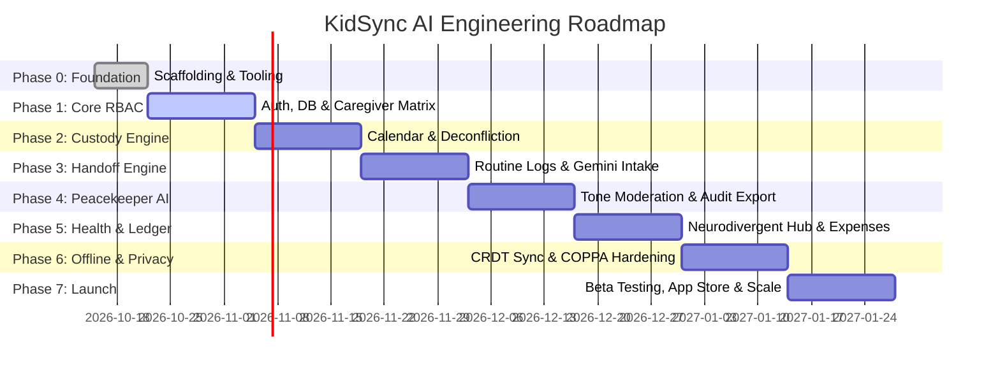

# Implementation Roadmap & Phased Execution Plan
## Project: KidSync AI
### Document Version: 1.0.0 | Status: Active Milestone Plan

---

## 1. Roadmap Overview & Timeline

The implementation of **KidSync AI** is structured into 8 sequential, milestone-driven phases. Each phase represents an atomic, testable, and demonstrable increment of the system, moving from foundational infrastructure to enterprise-grade AI orchestration and multi-platform deployment.

---

## 2. Milestone Tracking Dashboard

| Phase | Phase Name | Status | Target Delivery | Key Milestone Deliverable |
| :--- | :--- | :--- | :--- | :--- |
| **Phase 0** | Setup & Monorepo Foundation | `COMPLETED` | Week 1 | Turborepo, CI/CD, Prisma/SQLAlchemy, UI token kit |
| **Phase 1** | Identity, RBAC, Caregivers & Audit Schema | `COMPLETED` | Week 3 | PostgreSQL DDL, FastAPI async routes, Pydantic v2, HMAC audit chain |
| **Phase 2** | Autonomous Matching & Dynamic Trust Engine | `COMPLETED` | Week 5 | PyTorch Two-Tower neural model, Bayesian Dynamic Trust, /rank endpoint |
| **Phase 3** | Real-Time Telemetry, Backups & NLP Summaries | `COMPLETED` | Week 7 | WebSockets, telemetry pipeline, NLP EOD summary, backup fallback |
| **Phase 4** | Interactive Custody Calendar & Deconfliction | `PLANNED` | Week 9 | 2-2-3 / custom schedules, holiday matrix, swap workflow |
| **Phase 5** | Peacekeeper AI & Court-Audit Trail | `PLANNED` | Week 11 | Real-time tone rewriting, tamper-evident PDF export |
| **Phase 6** | Health, Neurodivergent Hub & Ledger | `PLANNED` | Week 13 | Medication logs, sensory triggers, receipt OCR & splits |
| **Phase 7** | Offline CRDT Sync & Security Audit | `PLANNED` | Week 15 | Full offline operation, COPPA/HIPAA penetration test |
| **Phase 8** | Multi-Platform Polish & Beta Launch | `PLANNED` | Week 17 | iOS TestFlight, Android Play Console, Web production |

---

## 3. Detailed Phase Specifications

### Phase 0: Project Setup, Monorepo Scaffolding & Tooling
- **Primary Objective:** Establish the complete monorepo structure, shared libraries, linting/formatting pipelines, and cloud sandbox environments.
- **Detailed Tasks:**
  - [x] Initialize Turborepo with PNPM workspaces (`apps/mobile`, `apps/web`, `packages/*`).
  - [x] Configure strict TypeScript (`tsconfig.base.json`), ESLint, Prettier, and Husky pre-commit hooks.
  - [x] Set up PostgreSQL 16 database instance (Supabase/Docker) and initialize Prisma ORM in `packages/database`.
  - [x] Scaffold shared packages: `@kidsync/shared-types`, `@kidsync/validation`, and `@kidsync/ui-kit`.
  - [x] Establish GitHub Actions CI pipeline for automated lint, typecheck, and test execution.
- **Exit Criteria:** Zero-warning build across all packages; CI runs successfully on pull requests.

---

### Phase 1: Identity, RBAC, Caregivers, Bookings & Audit Trail
- **Primary Objective:** Build secure authentication, caregiver delegation, childcare bookings, and court-admissible cryptographic audit logging.
- **Detailed Tasks:**
  - [x] Create PostgreSQL DDL schema (`migrations/001_initial_schema.sql`) for `users`, `caregivers`, `caregiver_assignments`, `bookings`, and `audit_log_entries`.
  - [x] Configure SQLAlchemy 2.0 Async ORM models with `greenlet`, `asyncpg`, and UUID primary keys.
  - [x] Implement Pydantic v2 validation schemas with strict typing, time range validation, and pagination.
  - [x] Build asynchronous repository and service layers with Clean Architecture.
  - [x] Implement HMAC-SHA256 court-admissible audit chaining and verification endpoint.
  - [x] Set up FastAPI v1 router with JWT Bearer authentication, RBAC dependency guards, and global error taxonomy.
  - [x] Configure Alembic async database migration environment.
  - [x] Write integration smoke test suite (`tests/test_api_smoke.py`) verifying E2E workflow and cryptographic integrity.
- **Exit Criteria:** Multi-caregiver families can invite users with varying roles, verify permission boundaries, book care sessions with deconfliction, and verify tamper-evident audit trails.

---

### Phase 2: Autonomous Matching, Verification & Dynamic Trust
- **Primary Objective:** Deliver an AI-powered ranking and verification engine that matches caregivers to families using PyTorch Two-Tower neural embeddings and Bayesian Dynamic Trust calculations.
- **Detailed Tasks:**
  - [x] Implement multi-factor `DynamicTrustEngine` (`src/ml/trust_engine.py`):
    - Identity & Background verification pillar (30% weight, recency decay).
    - Competency & certification scoring (25% weight, CPR/First Aid, Special Needs, ECE bonuses).
    - Reliability & Bayesian smoothed review rating (25% weight, completion rate analysis).
    - Safety & cryptographic audit integrity (20% weight, automated incident penalties).
  - [x] Build PyTorch Two-Tower Neural Ranking Model (`src/ml/models.py`):
    - `FamilyTower`: Encodes child age bucket, neurodivergent needs, specialties, budget, and urgency into $\mathbb{R}^{32}$.
    - `CaregiverTower`: Encodes experience, credentials, trust, review volume, and hourly rate into $\mathbb{R}^{32}$.
    - `RankingHead`: Combines cosine similarity, trust score norm, affordability, and specialty overlap.
  - [x] Implement `AutonomousMatchingService` (`src/ml/ranking_service.py`):
    - Live candidate retrieval and pre-filtering by minimum trust threshold.
    - PyTorch batch tensor forward pass.
    - Human-readable explainable match justification generator.
  - [x] Create FastAPI matching endpoints (`src/api/v1/matching.py`):
    - `POST /api/v1/matching/rank` for real-time candidate search and ranking.
    - `GET /api/v1/matching/trust-score/{caregiver_id}` for granular trust breakdowns.
  - [x] Develop unit and integration test suite (`tests/test_matching_ml.py`) with 100% pass rate.
- **Exit Criteria:** Families receive sub-second ranked caregiver recommendations ordered by neural compatibility and verified dynamic trust.

---

### Phase 3: Real-Time Telemetry, Backups & NLP Summaries
- **Primary Objective:** Provide live tracking of childcare sessions via WebSockets, generate daily NLP handoff briefs, and orchestrate automated backup caregiver fallback.
- **Detailed Tasks:**
  - [x] Implement WebSocket Connection Manager (`src/services/telemetry_manager.py`) with room broadcasting per booking.
  - [x] Build Real-Time Telemetry Pipeline (`src/api/v1/telemetry.py`):
    - Status transitions (`CHECK_IN` -> `IN_PROGRESS`, `CHECK_OUT` -> `COMPLETED`).
    - Real-time logging of meals, naps, photo-verified medications, moods, and incidents.
  - [x] Implement NLP End-of-Day Summary Generator (`src/services/nlp_summary_service.py`):
    - Synthesizes metrics (sleep minutes, meal completion %, medication adherence, average mood).
    - Generates coherent transition narrative and actionable reminders for parents.
    - Persists into `EODSummaryModel` and logs to court-admissible audit ledger.
  - [x] Build Automated Backup Caregiver Fallback Engine (`src/services/fallback_service.py`):
    - Triggers emergency replacement when primary caregiver cancels or is unresponsive.
    - Queries PyTorch Two-Tower model to rank eligible replacement caregivers (Trust $\ge 75$).
    - Automatically reassigns booking, logs audit trail, and broadcasts WebSocket alerts.
  - [x] Write end-to-end integration test suite (`tests/test_phase3_realtime_backup.py`) with 100% pass rate.
- **Exit Criteria:** Real-time bi-directional telemetry flows with sub-200ms latency, daily NLP digests are automatically generated, and emergency backup caregivers are dispatched instantaneously upon primary caregiver unavailability.

---

### Phase 4: Peacekeeper AI Communication Hub & Court-Audit Trail
- **Primary Objective:** Establish conflict-free co-parent messaging with real-time tone moderation and tamper-evident audit exports.
- **Detailed Tasks:**
  - [ ] Build real-time 1-on-1 and family chat channels using WebSockets and Redis Pub/Sub.
  - [ ] Implement **Peacekeeper AI Tone Analyzer**:
    - Real-time debounced tone sentiment scoring (Hostility, Blame, Passive-Aggression).
    - "Rewrite with Grace" suggestion generator utilizing Non-Violent Communication (NVC) frameworks.
  - [ ] Build the Recipient Hostility Shield (collapses inflammatory messages with neutral summary until user clicks "View Raw").
  - [ ] Implement SHA-256 Merkle-tree hash-chained audit logging for every message, edit, and read receipt.
  - [ ] Build Court-Admissible PDF Export Generator:
    - Cryptographic timestamp verification.
    - Certified compliance certificate adhering to Federal Rules of Evidence 902(11) & (14).
    - Tamper-evident verification QR code.
- **Exit Criteria:** Peacekeeper AI detects hostile prompts with $>90\%$ precision; court export generates a certified PDF with verifiable cryptographic hash chains.

---

### Phase 5: Child Health, Neurodivergent Hub & Financial Ledger
- **Primary Objective:** Provide specialized health tracking for neurodivergent needs, medication safety protocols, and receipt-splitting ledgers.
- **Detailed Tasks:**
  - [ ] Build Medication Administration Tracker:
    - Strict dosage schedules, photo confirmation of administration, and missed-dose alerts.
  - [ ] Build Neurodivergent Sensory & Behavior Tracker:
    - Track sensory triggers (auditory, tactile, visual), duration of dysregulation, and calming interventions.
    - Correlate sleep/meal events with behavioral meltdowns.
  - [ ] Build Emergency Medical Quick-Card (offline cached profile with allergies, blood type, insurance).
  - [ ] Build Shared Financial Ledger:
    - Gemini Multimodal OCR for receipt image processing (merchant, line items, total).
    - Customizable split ratios (50/50, proportional to income, 100% designated).
    - Expense approval, dispute resolution, and payment settlement links (Stripe/Venmo).
- **Exit Criteria:** Medications cannot be logged as double-dosed within safety thresholds; receipts are scanned into structured line items with $>95\%$ accuracy.

---

### Phase 6: Offline-First Synchronization & Privacy Hardening
- **Primary Objective:** Ensure rock-solid offline operation and complete legal compliance with COPPA, GDPR-K, and HIPAA principles.
- **Detailed Tasks:**
  - [ ] Implement WatermelonDB local SQLite persistence and mutation queue on React Native.
  - [ ] Build bidirectional synchronization protocol with Last-Write-Wins and 3-way merge resolution.
  - [ ] Implement Client-Side PII Sanitization pipeline before sending data to external AI models.
  - [ ] Conduct end-to-end security audit and penetration testing:
    - Row-Level Security verification on PostgreSQL.
    - Encryption-at-rest and in-transit audit.
    - Account data deletion and right-to-be-forgotten compliance routines.
- **Exit Criteria:** Full application features function in airplane mode and synchronize cleanly upon reconnection without data loss or corruption.

---

### Phase 7: Multi-Platform Polish, Beta Testing & Launch
- **Primary Objective:** Finalize user experience, perform load testing, execute private beta with 100 families, and deploy to production app stores.
- **Detailed Tasks:**
  - [ ] Conduct 6-pillar UI/UX audit for accessibility (WCAG 2.1 AA), typography, and haptic feedback.
  - [ ] Execute private closed beta with 100 diverse families (co-parents, special needs parents, working parents with nannies).
  - [ ] Run synthetic load testing (10,000 concurrent WebSocket connections; 1,000 requests/sec).
  - [ ] Build and submit iOS bundle to Apple TestFlight and App Store review.
  - [ ] Build and submit Android bundle to Google Play Console.
  - [ ] Deploy Web Portal and Verification Viewer to Vercel production edge.
- **Exit Criteria:** Crash-free sessions $>99.5\%$; App Store and Google Play approvals granted; public launch live.

---

## 4. Risk Assessment & Mitigation Strategies

| Risk Description | Severity | Likelihood | Mitigation Strategy |
| :--- | :--- | :--- | :--- |
| **High AI Latency during live message drafting** | High | Medium | Utilize Gemini 1.5 Flash with sub-600ms latency; debounce input by 400ms; cache common phrases. |
| **Data sync conflicts when co-parents edit schedule simultaneously** | Medium | Medium | Field-level vector clocks; formal swap workflow requires dual confirmation rather than raw edits. |
| **Caregiver reluctance to accept AI tone suggestions** | Medium | High | Maintain non-judgmental, constructive UI; show recipient-side empathy preview; allow sending original text if insisted. |
| **Legal challenges to audit PDF admissibility in family court** | High | Low | Align metadata and cryptographic hashing with Federal Rules of Evidence 902(11)/(14); provide attorney verification guide. |
| **Accidental exposure of child health PII** | Critical | Low | Zero-trust architecture; database row-level security; client-side tokenization before AI inference; automated daily vulnerability scans. |
