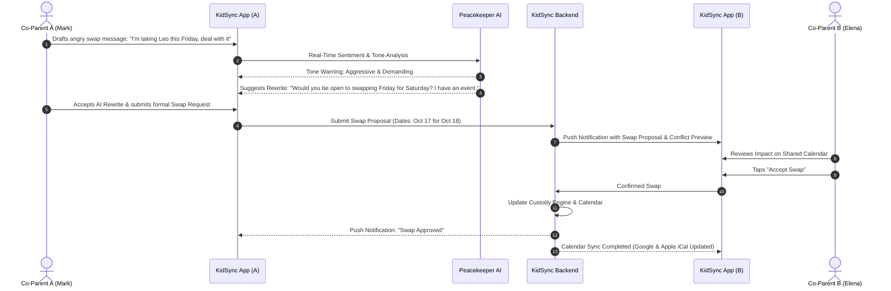

# Product Requirements Document (PRD)
## Project: KidSync AI
### Document Version: 1.0.0 | Status: Approved Baseline

---

## 1. Executive Summary

### 1.1 Vision & Mission
**KidSync AI** is an intelligent, multi-caregiver synchronization and co-parenting platform engineered to eliminate parental cognitive overload, miscommunication, and care fragmentation. Modern childcare frequently spans co-parents across two households, blended families, working parents, nannies, grandparents, teachers, and pediatricians. KidSync AI serves as an objective, centralized co-pilot that synchronizes schedules, routines, medications, expenses, and milestones, while leveraging artificial intelligence to mediate interpersonal communication, automate handoff reports, and safeguard child well-being.

### 1.2 Core Value Propositions
1. **Frictionless Co-Parenting Communication ("Peacekeeper AI"):** Eliminates high-conflict interactions through real-time tone analysis, de-escalation suggestions based on Non-Violent Communication (NVC) principles, and court-admissible, tamper-evident audit trails.
2. **Context-Aware Handoff Digests:** Synthesizes disparate daily inputs (meals, naps, medication, mood, school notices) into proactive, consumable briefings at custody or caregiver transitions.
3. **Smart Custody & Schedule Deconfliction:** Intelligently models complex custody patterns (2-2-3, 2-2-5-5, alternating weekends, holidays) with natural language swap requests and calendar integrations.
4. **Child Health & Neurodivergent Routine Hub:** Secure tracking for medications, symptom timelines, allergies, growth milestones, and sensory/behavioral triggers for neurodivergent children (ADHD, ASD).
5. **Transparent Expense & Receipts Ledger:** Automated receipt digitization (OCR), expense splitting (50/50, proportional, or custom), dispute workflows, and payment tracking.
6. **Privacy-by-Design Architecture:** Rigorous compliance with COPPA (Children’s Online Privacy Protection Act), GDPR-K, and HIPAA principles for sensitive pediatric data.

---

## 2. Problem Statement & Market Analysis

### 2.1 The Parenting & Co-Parenting Crisis
- **Fragmented Communication:** Child logistics are currently scattered across SMS, WhatsApp, emails, paper school notes, and verbal handoffs. Vital medical or dietary details get lost.
- **High-Conflict Co-Parenting:** In separated families, written communication often becomes emotional, accusatory, and counterproductive, causing emotional strain on both children and parents.
- **Mental Load & Asymmetric Information:** One caregiver typically shoulders the burden of remembering medications, clothing sizes, upcoming vaccinations, and school permission slips.
- **Inadequate Existing Tools:** Existing co-parenting apps (e.g., OurFamilyWizard, Talking Parents) are legacy, clunky, litigious-feeling, and lack predictive AI, automated handoffs, or voice-first multimodal input.

### 2.2 Target Personas

| Persona | Archetype | Pain Points | Primary Jobs to be Done |
| :--- | :--- | :--- | :--- |
| **Separated Co-Parents** *(Elena & Mark)* | Shared custody (50/50) of a 7-year-old. Tense, low-trust communication. | Arguments over schedule changes; lost school notifications; disputed medical bills. | Neutral communication; immutable proof of notices; clear expense division; schedule swap tracking. |
| **Dual-Career Parents + Nanny** *(Sarah, David & Maria)* | Working parents with an infant (9 mos) and toddler (3 yrs) managed by a full-time nanny. | Lack of visibility during the day; forgotten medication doses; repeated questions about nap schedules. | Quick voice logging for nanny; daily handover digest; medication verification photos; milestone log. |
| **Neurodivergent Family** *(Alex & Jordan)* | Parents of a 6-year-old on the Autism Spectrum (ASD). | Inconsistent routines trigger meltdowns; sensory triggers need strict recording across therapists and parents. | Precise sensory trigger logging; visual schedule sync; behavioral trend analysis; therapy goal tracking. |
| **Extended Family Caregivers** *(Grandparents / Babysitters)* | Weekend care providers who are less tech-savvy. | Difficulty navigating complex apps; fear of administering wrong medicine or missing nap times. | Simplified "Caregiver View"; single-tap voice logging; clear emergency contacts and allergy cards. |

---

## 3. Goals and Non-Goals

### 3.1 Business & Product Goals
- **G1 (De-escalation):** Reduce perceived conflict in caregiver communications by at least 65% through real-time AI tone mediation.
- **G2 (Cognitive Offload):** Cut daily caregiver coordination time from an average of 45 minutes/day to under 5 minutes/day through automated handoff summaries.
- **G3 (Single Source of Truth):** Achieve zero missed critical medical events (medications, allergic reactions, vaccines) through verified confirmation workflows.
- **G4 (Audit-Ready Immutability):** Provide court-accepted, cryptographic PDF exports of communications, expenses, and schedules for legal proceedings.
- **G5 (Engagement):** Achieve Daily Active User to Monthly Active User ratio (DAU/MAU) > 60% for active caregivers.

### 3.2 Non-Goals (Out of Scope for v1)
- **NG1:** Direct telemedicine diagnosis or prescription services (KidSync AI assists tracking and triage summary for pediatricians, not direct medical advice).
- **NG2:** Banking license or direct financial custody (KidSync AI integrates with Stripe Connect, Venmo, and PayPal for settlements, but does not hold escrow funds).
- **NG3:** Constant real-time GPS tracking or geofencing (KidSync AI is not a surveillance or child-tracking spyware app; it is a collaborative logistics platform).
- **NG4:** Legal representation or automated legal arbitration.

---

## 4. Key Features & Functional Requirements

### 4.1 "Peacekeeper AI" Communication Engine
- **FR-COMM-01: Real-time Tone & Sentiment Analysis:** As users draft messages, the AI evaluates tone across hostility, blame, passive-aggression, and emotional charge.
- **FR-COMM-02: "Rewrite with Grace" (NVC Transformation):** One-tap suggestion to rephrase inflammatory text into neutral, child-centric, factual statements.
  - *Example:* "You always forget his inhaler because you don't care" $\rightarrow$ "Please remember to pack Milo's inhaler for tomorrow's handoff."
- **FR-COMM-03: Hostility Shield:** Optional parental setting that flags incoming toxic messages and displays a neutralized summary until the recipient chooses to view the raw text.
- **FR-COMM-04: Court-Admissible Audit Export:** Cryptographically stamped PDF/CSV export containing tamper-evident timestamps, message delivery statuses, unedited raw logs, and read receipts.
- **FR-COMM-05: Emergency Broadcast Mode:** Bypasses all AI queues and filters for urgent safety, medical, or immediate pickup issues, triggering instant push and SMS alerts.

### 4.2 Automated Caregiver Handoff Engine
- **FR-HAND-01: Scheduled Transition Digests:** Automatically compiles and delivers a structured handoff briefing 30 minutes before a scheduled custody or shift transfer.
- **FR-HAND-02: Digest Composition:**
  - *Nutrition:* Last meal/bottle timing, quantity consumed, appetite rating.
  - *Sleep:* Total nap duration, wake-up time, sleep quality score.
  - *Medical:* Medications administered (with exact timestamp and dose), pending doses.
  - *Mood & Sensory:* Mood state (1–5 scale), notable behavioral triggers or achievements.
  - *Action Items:* Homework due, permission slips required, clothes needed for tomorrow.
- **FR-HAND-03: Multi-Modal Quick Intake:** Caregivers can submit updates via 10-second voice notes or photos (e.g., photo of medicine bottle or school assignment) parsed into structured data by Gemini Multimodal models.

### 4.3 Intelligent Custody Calendar & Deconfliction
- **FR-CAL-01: Standard & Custom Custody Templates:** Support for 2-2-3, 2-2-5-5, alternating weeks, every other weekend, and custom recurring patterns.
- **FR-CAL-02: Holiday & Vacation Splitter:** Built-in odd/even year holiday rotation matrix (Thanksgiving, Christmas, Spring Break, birthdays, summer blocks).
- **FR-CAL-03: Formal Swap Request Workflow:** Structured flow for requesting schedule trades:
  - Select target date $\rightarrow$ Offer compensation date $\rightarrow$ Automated calendar impact preview $\rightarrow$ Accept/Decline/Counter $\rightarrow$ Auto-update shared calendar upon dual consent.
- **FR-CAL-04: External Calendar Sync:** Two-way iCal / Google Calendar / Outlook Calendar feed with customizable privacy filters (e.g., hiding private details from non-guardian calendars).

### 4.4 Child Health, Routine & Neurodivergent Hub
- **FR-HLTH-01: Medication Administration Log:** Timed medication schedules with photo-verified administration, dosage logs, and refill alerts.
- **FR-HLTH-02: Emergency Medical & Allergy Quick-Card:** Offline-accessible emergency profile featuring blood type, allergies, critical medications, insurance policy numbers, and primary pediatrician contact.
- **FR-HLTH-03: Pediatric Visit Prep & Export:** 30-day symptom and medication log compiled into a clean 1-page PDF for the child’s pediatrician.
- **FR-HLTH-04: Neurodivergent Tracker (Sensory & Behavior):** Customizable logs for sensory inputs (noise, texture, light), emotional dysregulation events, duration, antecedent triggers, and effective de-escalation calming techniques.
- **FR-HLTH-05: Milestone Tracker:** Developmental timeline tracking (motor, cognitive, speech, social) mapped against CDC and AAP milestones with photo/video attachments.

### 4.5 Financial Ledger & Receipt Splitting
- **FR-FIN-01: Multimodal Receipt Scanning:** AI OCR parses merchant name, date, total amount, and line items from a photographed receipt.
- **FR-FIN-02: Customizable Split Ratios:** 50/50, proportional by agreed income percentages, or 100% assigned to a specific parent per expense category (Medical, Education, Extracurricular, Clothing).
- **FR-FIN-03: Expense Approval & Dispute Pipeline:** Parent submits expense with receipt $\rightarrow$ Other parent notified $\rightarrow$ 72-hour review window to approve or request clarification $\rightarrow$ Status recorded in tamper-evident ledger.
- **FR-FIN-04: Payment Settlement Integration:** Direct deep-links to settle balances via Stripe, Venmo, PayPal, or mark as "Paid in Cash" with receipt acknowledgement.

### 4.6 Role-Based Access Control (RBAC) & Caregiver Circles
- **FR-RBAC-01: Tiered Permissions:**
  - *Primary Guardians (Parents):* Full read/write access to financials, legal logs, medical records, chat.
  - *Extended Guardians (Stepparents):* Configurable access to calendar, health, routines; optional financial exclusion.
  - *Care Providers (Nannies, Babysitters):* Access restricted to daily log, emergency card, routine checklist; strictly no financial or court-chat access.
  - *Educational/Medical Observers (Pediatrician, Therapist, Teacher):* View-only export access to relevant logs upon authorized parent consent.
- **FR-RBAC-02: Multi-Child Household Support:** Granular switching between children with individual schedules, health profiles, and expense tracking.

---

## 5. Non-Functional Requirements (NFRs)

### 5.1 Security & Data Privacy
- **NFR-SEC-01 (COPPA & GDPR-K Compliance):** No child data shall ever be sold, monetized, or shared with third-party advertisers. All parental consents cryptographically validated.
- **NFR-SEC-02 (Encryption):** AES-256 encryption at rest; TLS 1.3 in transit. End-to-End Encryption (E2EE) using Signal Protocol / WebCrypto for private direct messages between guardians.
- **NFR-SEC-03 (Audit Trail Immutability):** Communication logs and financial approvals are hashed using SHA-256 and stored with immutable append-only timestamps to satisfy court evidentiary requirements (Federal Rules of Evidence 902(11) & (14)).
- **NFR-SEC-04 (Role-Based Field Redaction):** Caregiver roles automatically redact sensitive financial, legal, and co-parenting dispute history at the API layer.

### 5.2 Performance, Reliability & Offline-First
- **NFR-PERF-01 (Offline-First Architecture):** Full offline reading and logging capabilities on mobile clients using local SQLite/CRDT storage; automatic two-way synchronization upon network restoration.
- **NFR-PERF-02 (Latency):**
  - AI Tone analysis feedback $\le 800\text{ ms}$ round-trip.
  - Real-time chat message delivery $\le 200\text{ ms}$.
  - Daily Handoff Digest generation $\le 2.5\text{ seconds}$.
- **NFR-PERF-03 (Availability):** 99.9% uptime SLA for core sync, calendar, and messaging services.
- **NFR-PERF-04 (Scalability):** Designed to handle 500,000 concurrent active families with sub-second message dispatch and horizontal auto-scaling.

### 5.3 Usability & Accessibility
- **NFR-ACC-01:** Conformance with WCAG 2.1 AA standards, supporting high-contrast mode, dynamic text scaling, and full screen reader compatibility (VoiceOver, TalkBack).
- **NFR-ACC-02:** Low-stress visual design: Calm, muted color palette engineered to reduce cortisol levels and prevent escalation during emotional parenting disputes.

---

## 6. User Journeys & End-to-End Scenarios

### Scenario 1: The High-Tension Schedule Swap

### Scenario 2: The Afternoon Caregiver Handoff
1. **1:30 PM:** Nanny Maria snaps a photo of 4-year-old Maya’s lunch plate and records voice note: *"Maya ate half her turkey sandwich, had water, took 2.5ml Zyrtec at 1:15 PM, and is down for her nap."*
2. **AI Processing:** Gemini Multimodal extracts:
   - Meal: Turkey sandwich (50% consumed).
   - Medication: Zyrtec 2.5ml administered at 13:15.
   - Sleep: Nap initiated at 13:30.
3. **4:30 PM (Transition Window):** Dad David leaves work for pickup.
4. **KidSync Notification:** Push notification delivers **Automated Handoff Card**:
   - *"Maya slept 1h 45m. Meds: Zyrtec given at 1:15 PM (Next dose not due today). Mood: Happy. Reminder: Bring soccer boots from home."*
5. **Outcome:** Zero text back-and-forth; zero risk of double-dosing medicine.

---

## 7. Success Metrics (KPIs)

| Metric | Target (Month 3) | Target (Month 12) | Measurement Method |
| :--- | :--- | :--- | :--- |
| **Conflict Reduction Rate** | > 45% rewrites accepted | > 70% rewrites accepted | In-app tone prompt acceptance analytics |
| **Missed Medication Incidents** | < 0.05% of logged doses | 0.00% reported incidents | User incident reporting & confirmation logs |
| **Handoff Digest Read Rate** | > 80% within 45 mins | > 92% within 30 mins | Push notification open & digest view events |
| **Schedule Swap Approval Rate** | > 75% agreed without dispute | > 88% agreed without dispute | Completed swap request status |
| **OCR Receipt Accuracy** | > 94% item/total accuracy | > 98.5% item/total accuracy | User correction rate during expense creation |
| **30-Day Caregiver Retention** | > 55% | > 72% | Cohort analytics |

---

## 8. Release Strategy & Roadmap Highlights
- **v1.0 (MVP):** Core RBAC, Interactive Custody Calendar, Daily Routine Logs with Voice Intake, Peacekeeper AI Chat with tone mediation, Basic Handoff Digest, and Emergency Card.
- **v1.5:** Multimodal Receipt OCR, Expense Split Ledger, Google/Apple Calendar 2-way sync, Court-Admissible PDF Export.
- **v2.0:** Neurodivergent Sensory & Behavior Analytics, School LMS (Canvas/Google Classroom) sync, Smart Pediatrician Portal, Wearable Health integration (Apple Watch / Fitbit).
